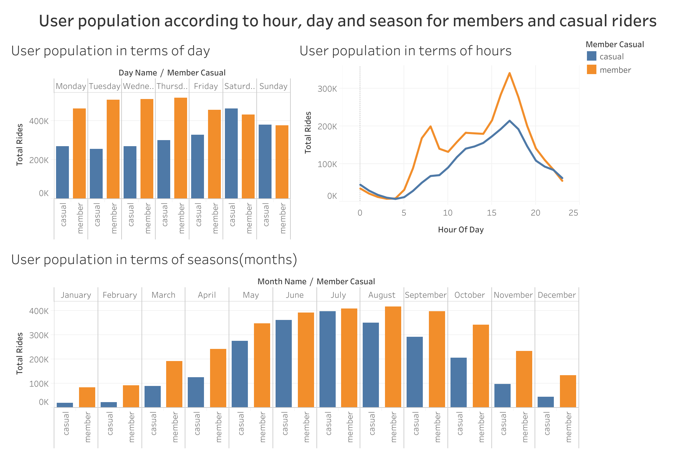
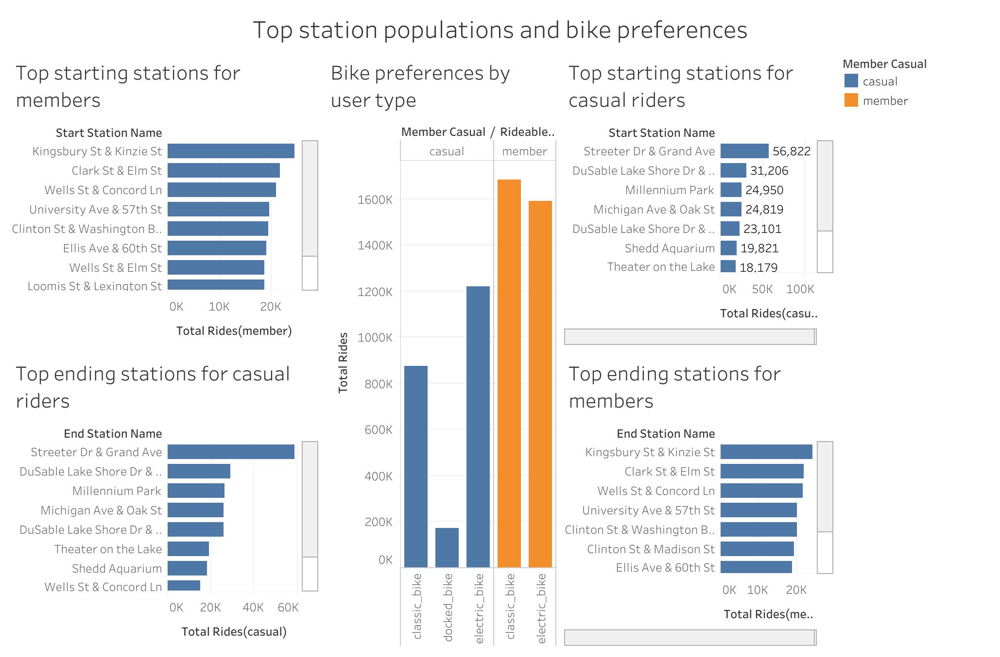

# Cyclistic Bike-Share Case Study: Converting Casual Riders to Annual Members

[**View the Interactive Tableau Dashboards Here**]
https://public.tableau.com/app/profile/moe.zune.thway8817/viz/CyclisticCaseStudy2_17936433034820/Dashboard2

https://public.tableau.com/app/profile/moe.zune.thway8817/viz/CyclisticCaseStudy_17936432608260/Dashboard1
---

## 📊 Business Task

Cyclistic aims to increase the number of annual memberships, which generate greater profitability than single-ride and full-day passes. To support this business objective, the marketing team seeks to better understand the behavioral differences between annual members and casual riders. 

The primary business task of this analysis is to identify how these two customer segments use Cyclistic bikes differently by examining historical trip data. The insights derived from this analysis will help inform data-driven marketing strategies designed to convert casual riders into annual members, ultimately contributing to membership growth and long-term business success.

**Key Stakeholders:**
* Lily Moreno, Director of Marketing
* Cyclistic Marketing Analytics Team
* Cyclistic Executive Team

---

## 📂 Data Sources & Credibility

The data used in this analysis consists of 12 months of historical data which is made available by Motivate International Inc. 

* **Content:** The datasets contain ride-level information such as `ride_id`, `rideable_type`, the journey start and end time, station names, `station_coordinates`, and rider type (member or casual). 
* **Privacy:** The data was provided as separate monthly CSV files covering a one-year period. The data is publicly available and does not contain personally identifiable information, ensuring compliance with privacy requirements.
* **Credibility (ROCC):** The data is reliable because it is collected directly from cyclistic operations and also it is first-party operational data.

---

## 🛠️ Phase: Data Process & Cleaning Documentation

### 1. Tools Chosen
* **Tool:** SQL (Relational Database)
* **Reasoning:** The dataset contains millions of rows across multiple months, which exceeds the limitations of standard spreadsheet software like Excel or Google Sheets. SQL allows for efficient, reproducible data manipulation and cleaning.

### 2. Data Exploration & Integrity Checks
Before altering the data, I explored the raw tables to understand anomalies, missing data, and inconsistencies.
* **Schema Verification:** Inspected the first 10 rows to ensure data types matched expectations. *(See Figure 1)*
* **Categorical Consistency:** Checked the `member_casual` and `rideable_type` columns. No misspelled or unexpected categories were found. *(See Figure 2)*
* **Null Value Investigation:** I discovered missing values in `start_station_name` and `end_station_name`. Upon further query, I found that many of these nulls were tied to `electric_bike` rides, which can be parked in dockless locations rather than official stations.

### 3. Data Cleaning & Transformation Steps
To prepare the data for analysis, I created a new table (`bike_trips_cleaned`) and applied the following transformations:

* **Addressed Missing Data:** Electric bikes are designed with built-in locks allowing users to park them outside of official stations, meaning a null station name isn't an error—it is a functional feature of the product. If I deleted those rows, I would disproportionately erase electric bike trips, leading to inaccurate conclusions about overall ridership volume and user preferences. Conversely, classic bikes physically require a docking station to end a trip. A null station for a classic bike indicates genuine data corruption, an abandoned bike, or a stolen asset. Filtering these out ensures the analysis is built entirely on valid, completed rides. Therefore, instead of deleting null station names for electric bikes, I replaced them with 'Dockless Location' to preserve the trip data. For classic bikes, trips missing station names were filtered out. 
* **Created New Variables:**
  * Calculated `ride_length` by subtracting `started_at` from `ended_at`.
  * Extracted `day_of_week` from the `started_at` timestamp.
* **Removed Bad Data:** Filtered out negative or impossibly short rides (less than 1 minute), which likely represent false starts or maintenance checks.

```sql
-- SQL Query: Creating Cleaned Staging Table
CREATE TABLE bike_trips_cleaned AS
SELECT 
    ride_id,
    rideable_type,
    started_at,
    ended_at,
    TIMESTAMP_DIFF(ended_at, started_at, MINUTE) AS ride_length,
    EXTRACT(DAYOFWEEK FROM started_at) AS day_of_week,
    COALESCE(start_station_name, 
        CASE WHEN rideable_type = 'electric_bike' THEN 'Dockless Location' ELSE NULL END
    ) AS start_station_name,
    COALESCE(end_station_name, 
        CASE WHEN rideable_type = 'electric_bike' THEN 'Dockless Location' ELSE NULL END
    ) AS end_station_name,
    member_casual
FROM 
    raw_bike_trips
WHERE 
    TIMESTAMP_DIFF(ended_at, started_at, MINUTE) >= 1
    AND TIMESTAMP_DIFF(ended_at, started_at, HOUR) <= 24
    AND NOT (rideable_type = 'classic_bike' AND (start_station_name IS NULL OR end_station_name IS NULL));
```
I also decided to remove very long ride_length(more than 24 hrs)from my cleaned table since it can be expected that the bike was lost/stolen or to be faulty time measurement.
### 4. Verification
To verify the data was clean and ready for analysis, I compared the row counts of the raw and cleaned tables to understand how much data was removed, and found out 128,840 rows out of 5,667,717 rows were removed and confirmed that no negative `ride_length` values, duplicates remained and the missing values are handled properly.

---

## 📈 Key Insights & Dashboard Visualizations




### 1. The Commuter vs. The Tourist (Temporal Trends)
* **Members:** Ride volume spikes sharply Monday through Friday at **8:00 AM and 5:00 PM**, indicating heavy commuter utility for daily work routines.
* **Casual Riders:** Ride volume builds steadily on **Saturdays and Sundays**, peaking in the mid-afternoon for leisure and sightseeing.

### 2. The Summer Surge (Seasonality)
* Both user types ride more during warmer weather, but **casual rider volume specifically explodes between June and August** before dropping off significantly in the winter months.

### 3. Location & Equipment Preferences
* **Casual Riders:** Overwhelmingly start and end their trips at tourist hotspots and coastal locations (e.g., *Streeter Dr & Grand Ave*, *Millennium Park*).
* **Members:** Start trips primarily at inland, residential, and commercial transit hubs (e.g., *Kingsbury St & Kinzie St*).

---

## 💡 Strategic Recommendations

1. **Launch a Targeted Spring/Summer Campaign:** Initiate digital and physical marketing pushes starting in late May to intercept the massive June–August casual rider surge. 
2. **Deploy Geofenced & Physical Advertising:** Place physical conversion banners and ads specifically at the Top 5 Casual stations (e.g., *Streeter Dr & Grand Ave*, *Millennium Park*, *Shedd Aquarium*), rather than general citywide placements.
3. **Introduce a "Weekend Pass" Tier:** Because casual riders use the service primarily on weekends, a full 365-day membership can feel like an over-commitment. Introducing a discounted "Weekend-Only Annual Pass" will capture this specific audience and serve as a stepping stone toward full annual membership.